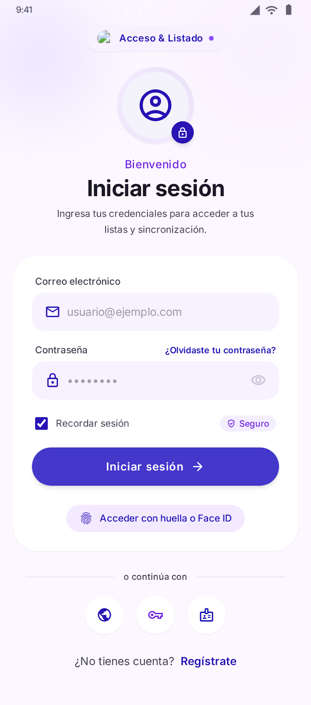
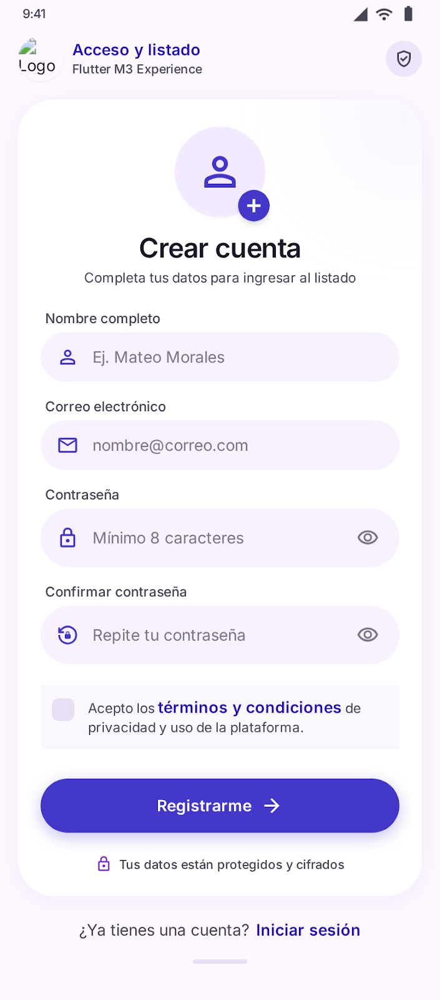
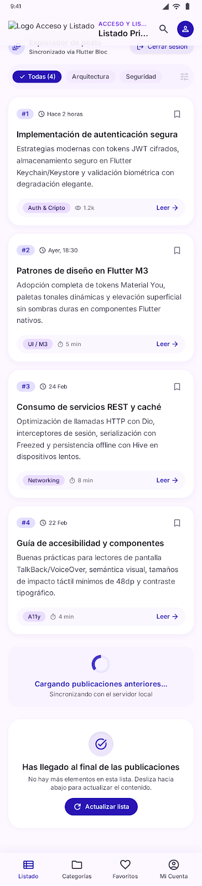
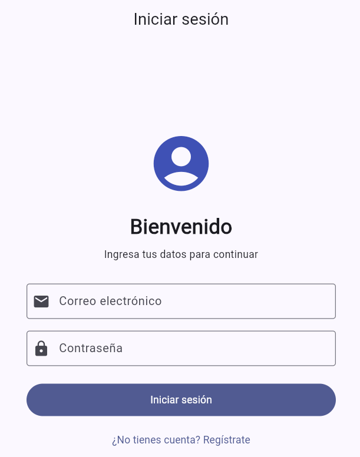
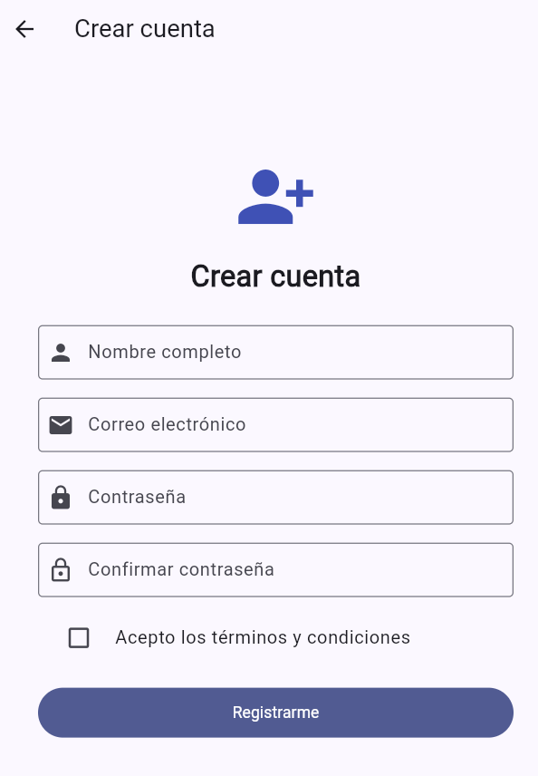
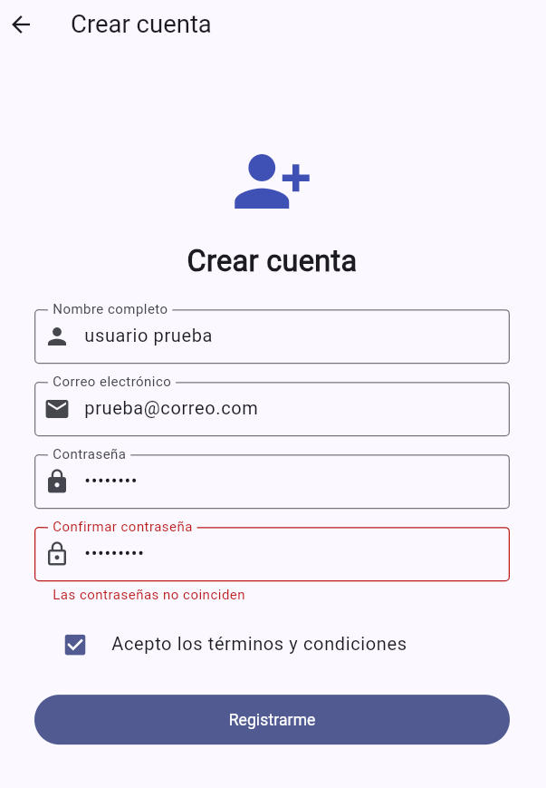
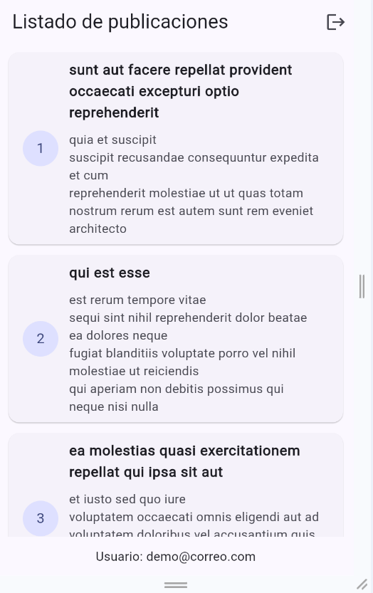
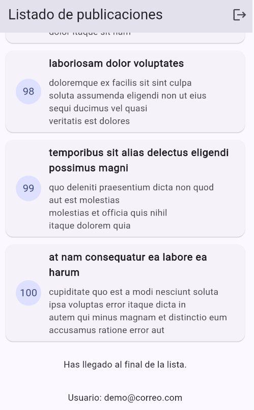
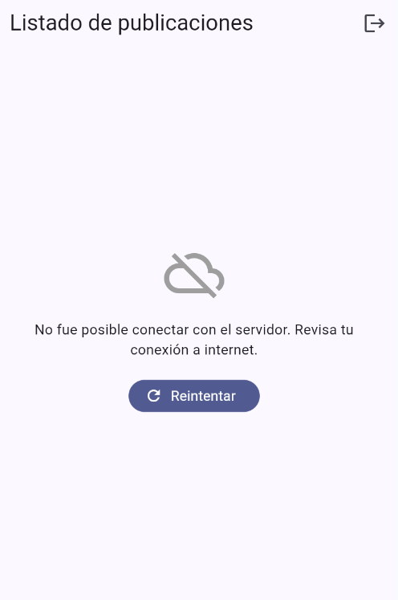

# Parcial 2 — Acceso y Listado

Aplicación desarrollada con **Flutter y Dart** para implementar un sistema de registro de usuarios, inicio de sesión y consulta de publicaciones mediante una API REST.

## 1. Descripción del proyecto

La aplicación cuenta con tres pantallas principales:

- **Inicio de sesión:** permite ingresar con una cuenta de demostración o una cuenta registrada durante la ejecución.
- **Registro:** permite crear un usuario mediante un formulario con validaciones.
- **Listado de publicaciones:** permite consultar publicaciones obtenidas desde un servicio REST, cargar nuevas páginas al desplazarse y cerrar sesión.

## 2. Tecnologías utilizadas

- Flutter y Dart.
- Riverpod para la administración del estado.
- Paquete `http` para consumir servicios REST.
- Material Design para la interfaz.
- Google Stitch para el diseño visual de las pantallas.
- Git y GitHub para el control de versiones.

## 3. Funcionalidades implementadas

### Inicio de sesión

- Validación de correo electrónico y contraseña.
- Inicio de sesión con credenciales de demostración.
- Inicio de sesión con un usuario registrado previamente.
- Mensajes de validación cuando los datos son incorrectos.
- Navegación a la pantalla de registro.
- Gestión de la sesión mediante Riverpod.

**Credenciales de demostración:**

- Correo: `demo@correo.com`
- Contraseña: `12345678`

### Registro de usuarios

- Validación de nombre completo.
- Validación del formato del correo electrónico.
- Contraseña de al menos ocho caracteres.
- Confirmación de contraseña.
- Verificación de coincidencia entre las contraseñas.
- Aceptación de términos y condiciones.
- Almacenamiento temporal del usuario mediante Riverpod.
- Retorno a la pantalla de inicio de sesión.

**Nota:** el registro es una implementación educativa que guarda un usuario en memoria. Los datos no permanecen almacenados después de reiniciar la aplicación.

### Listado de publicaciones

- Consulta HTTP GET a JSONPlaceholder.
- Presentación de publicaciones mediante tarjetas.
- Paginación de 15 publicaciones por solicitud.
- Carga progresiva al desplazarse hacia el final de la lista.
- Indicador de carga.
- Mensajes para errores de conexión.
- Botón para reintentar cuando una solicitud falla.
- Actualización manual de la lista.
- Mensaje al finalizar las publicaciones disponibles.
- Cierre de sesión.

**Servicio REST utilizado:**

`https://jsonplaceholder.typicode.com/posts`

## 4. Estados de la interfaz

El listado contempla cuatro estados principales:

1. **Carga:** se muestra un indicador mientras se consultan las publicaciones.
2. **Datos:** se presentan las publicaciones recuperadas.
3. **Error:** se informa cuando no es posible completar la solicitud y se ofrece reintentar.
4. **Vacío:** se presenta un mensaje cuando la consulta no devuelve publicaciones.

## 5. Organización del código

```text
lib/
├── main.dart
├── estado/
│   ├── publicaciones_provider.dart
│   ├── sesion_provider.dart
│   └── usuario_registrado_provider.dart
├── modelos/
│   └── usuario_registrado.dart
├── pantallas/
│   ├── login_screen.dart
│   ├── registro_screen.dart
│   └── listado_screen.dart
├── servicios/
│   └── publicaciones_api.dart
└── widgets/
    └── campo_formulario.dart
```

## 6. Instalación y ejecución

**Requisitos:**

- Flutter SDK instalado.
- Visual Studio Code con extensiones de Flutter y Dart, o un entorno compatible.
- Chrome o un dispositivo compatible.
- Conexión a internet para consultar la API.

**Procedimiento:**

Clonar el repositorio:

```bash
git clone https://github.com/RabinMonge/parcial2_acceso_listado.git
```

Ingresar a la carpeta:

```bash
cd parcial2_acceso_listado
```

Instalar las dependencias:

```bash
flutter pub get
```

Ejecutar la aplicación en Chrome:

```bash
flutter run -d chrome
```

Ejecutar las pruebas:

```bash
flutter test
```

## 7. Diseños realizados con Google Stitch

Se generaron tres propuestas visuales para las pantallas de la aplicación, utilizando un estilo consistente inspirado en Material Design 3.

### Diseño de inicio de sesión



### Diseño de registro



### Diseño de listado



**Enlace al proyecto de Google Stitch:**

[Ver los tres diseños originales en Google Stitch](https://stitch.withgoogle.com/projects/16257917731009157598)


## 8. Capturas de la aplicación funcionando

Las siguientes capturas muestran las pruebas de funcionamiento realizadas en Flutter.

### 8.1 Inicio de sesión

Pantalla de acceso con los campos de correo electrónico y contraseña.



### 8.2 Registro de usuario

Formulario para registrar una cuenta con validación de datos y aceptación de términos.



### 8.3 Validación de contraseñas

El formulario muestra un mensaje cuando la contraseña y su confirmación no coinciden.



### 8.4 Listado de publicaciones

Publicaciones recuperadas mediante una solicitud HTTP a la API REST.



### 8.5 Paginación infinita

La aplicación carga publicaciones progresivamente y muestra un mensaje cuando llega al final de la lista.



### 8.6 Manejo de errores de conexión

Cuando la solicitud HTTP falla, se muestra un mensaje de error y la opción de reintentar.




## 9. Diferencias entre los diseños y la implementación

Los diseños de Stitch se utilizaron como referencia visual. La aplicación implementada prioriza las funcionalidades solicitadas en el parcial.

Algunas diferencias son:

- El diseño de referencia incorpora opciones adicionales de autenticación que no forman parte de la implementación funcional.
- El listado implementado está conectado a una API REST real de pruebas e incorpora paginación, mensajes de error y acciones para reintentar las solicitudes.

## 10. Pruebas realizadas

Se realizaron comprobaciones de:

- Registro de usuario y validación de contraseñas.
- Inicio de sesión con credenciales de demostración.
- Inicio de sesión con una cuenta registrada.
- Navegación y cierre de sesión.
- Consulta de publicaciones desde la API.
- Carga progresiva y finalización de la lista.
- Manejo de errores de conexión y reintento.
- Ejecución de `flutter analyze` y `flutter test`.

## 11. Uso de herramientas de inteligencia artificial

Durante el desarrollo se utilizaron herramientas de asistencia de IA para apoyar la elaboración, revisión y explicación del código, así como Google Stitch para generar propuestas de diseño. La aplicación fue ejecutada y sus funcionalidades fueron comprobadas en el entorno de desarrollo.

## 12. Repositorio

https://github.com/RabinMonge/parcial2_acceso_listado
